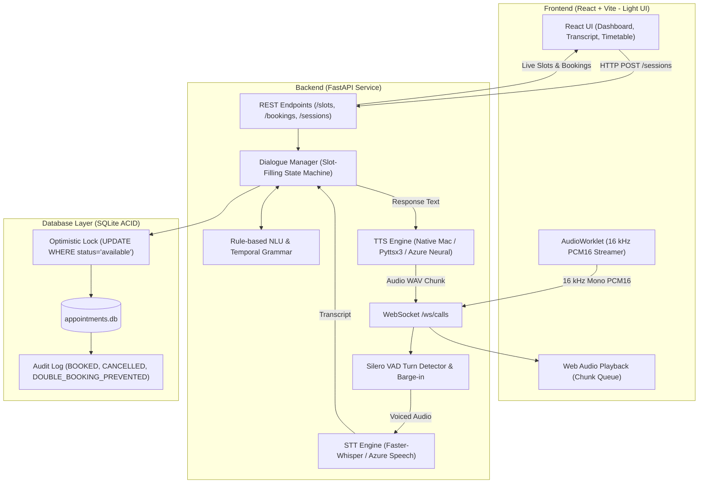

# PS02 Voice Appointment Booking Agent

> **Cerevyn Solutions – Round 1 Technical Assessment**  
> **Candidate:** Ashish Khatri  
> **Roll Number:** 2310991385  
> **Problem ID:** PS02 (Voice Agents Track)  
> **Branch:** Computer Science Engineering, Chitkara University  
> **Repository:** [`https://github.com/Ashish001123/cerevyn_chitkara_2310991385_PS02`](https://github.com/Ashish001123/cerevyn_chitkara_2310991385_PS02)

---

A production-ready voice appointment booking system built with **FastAPI**, **React (Vite)**, **SQLite**, and **Faster-Whisper**. The agent handles real-time conversational scheduling and cancellations across 3 service providers in Asia/Kolkata timezone (IST). It features strict concurrency controls preventing double bookings, intelligent alternative slot recommendations, low-latency audio streaming with barge-in support, and a complete 184-scenario automated test suite.

---

## System Architecture Diagram



---

## Project Structure

```
cerevyn_chitkara_2310991385_PS02/
├── backend/
│   ├── app/                 # Core backend application
│   │   ├── main.py          # FastAPI application, REST endpoints, WebSocket handler
│   │   ├── dialogue.py      # Multi-turn slot-filling state machine
│   │   ├── repository.py    # Database queries, atomic transactions, concurrency locks
│   │   ├── nlu.py           # Intent recognition and entity extraction
│   │   ├── temporal.py      # Indian date/time parsing grammar
│   │   ├── speech.py        # STT (Faster-Whisper) & TTS (NSSpeech / pyttsx3 / Azure)
│   │   ├── call.py          # Full-duplex live call session management
│   │   ├── turns.py         # End-of-turn detection & barge-in thresholds
│   │   └── config.py        # Environment variables & runtime settings
│   ├── data/                # SQLite database and seed definitions
│   │   └── seed.json        # 3 service providers & 15 appointment slots
│   ├── scripts/             # Operational and evaluation scripts
│   │   ├── init_db.py       # Database schema initialization and seeding
│   │   ├── run_demo.py      # End-to-end voice scenario demonstration runner
│   │   └── eval_noise.py    # Robustness evaluation against background noise
│   ├── tests/               # 184 automated pytest test scenarios
│   ├── samples/             # Sample WAV audio requests and request manifests
│   ├── demo_output/         # Evaluation reports and audio recordings
│   ├── infra/               # Azure Bicep infrastructure templates
│   ├── Dockerfile           # Production container build
│   └── requirements.txt     # Python backend dependencies
│
├── frontend/
│   ├── public/              # Static assets and AudioWorklet
│   │   └── pcm-processor.js # 16 kHz mono PCM16 AudioWorklet processor
│   ├── src/
│   │   ├── App.jsx          # Interactive React application (Voice Call & Dashboard)
│   │   ├── index.css        # Clean, modern Light Mode styling
│   │   └── main.jsx         # React application entry point
│   ├── package.json         # Frontend dependencies (React, Vite, Lucide)
│   └── vite.config.js       # Vite development proxy configuration
│
├── docs/                    # Azure deployment plan and architecture specs
├── .github/workflows/ci.yml # Automated GitHub Actions test workflow
└── README.md                # Project documentation and interview guide
```

---

## Requirement Traceability

| Requirement | Implementation Detail | Source Reference |
|---|---|---|
| **3 Service Providers & ≥12 Slots** | 3 providers (Dental, Salon, Physio) across 15 slots on Oct 20–21, 2026 (IST). | [`backend/data/seed.json`](file:///Users/ashish/Downloads/VoiceAgents/backend/data/seed.json) |
| **Real Speech STT & TTS** | On-device `faster-whisper` + native macOS synthesizer (or Azure Speech). | [`backend/app/speech.py`](file:///Users/ashish/Downloads/VoiceAgents/backend/app/speech.py) |
| **Slot-Filling Dialogue** | Step-by-step collection of Service, Name, Date, and Time with ambiguity checks. | [`backend/app/dialogue.py`](file:///Users/ashish/Downloads/VoiceAgents/backend/app/dialogue.py) |
| **Zero Hallucination / Alternatives** | Queries real DB rows; suggests nearest available slots when preferred time is taken. | [`backend/app/repository.py`](file:///Users/ashish/Downloads/VoiceAgents/backend/app/repository.py) |
| **Explicit Confirmation** | Requires unambiguous affirmation before modifying database state. | [`backend/app/dialogue.py`](file:///Users/ashish/Downloads/VoiceAgents/backend/app/dialogue.py) |
| **Double-Booking Prevention** | Atomic `UPDATE slots WHERE status='available'` with rowcount validation. | [`backend/app/repository.py`](file:///Users/ashish/Downloads/VoiceAgents/backend/app/repository.py) |
| **Appointment Cancellation** | Code-based lookup (`BKnnnnn`), confirmation read-back, atomic slot release. | [`backend/app/dialogue.py`](file:///Users/ashish/Downloads/VoiceAgents/backend/app/dialogue.py) |
| **Audit Logging** | Complete event trail (`BOOKED`, `CANCELLED`, `DOUBLE_BOOKING_PREVENTED`). | `booking_audit` table in SQLite |
| **Full-Duplex Audio & Barge-in** | Silero VAD turn detection, AudioWorklet 16 kHz streaming, immediate playback cutoff. | [`backend/app/call.py`](file:///Users/ashish/Downloads/VoiceAgents/backend/app/call.py) |
| **React Frontend (Light UI)** | Clean light-mode UI, live audio visualizer, timetable filter, state inspector. | [`frontend/src/App.jsx`](file:///Users/ashish/Downloads/VoiceAgents/frontend/src/App.jsx) |
| **Automated Testing** | 184 comprehensive scenarios passing in under 4 seconds. | [`backend/tests/`](file:///Users/ashish/Downloads/VoiceAgents/backend/tests) |

---

## Quick Start (macOS, Python 3.12+, Node 18+)

### 1. Backend Setup & Run

```bash
cd backend

# Create virtual environment and install dependencies
python3 -m venv .venv
source .venv/bin/activate
pip install -r requirements.txt

# Initialize database schema and seed fixtures
python scripts/init_db.py --reset

# Run full test suite (184 tests)
pytest -q

# Start FastAPI backend server
APP_NOW=2026-10-11T09:00:00+05:30 uvicorn app.main:create_app --factory --port 8000
```

### 2. Frontend Setup & Run (React Light Mode)

```bash
cd frontend

# Install node dependencies
npm install

# Start Vite development server
npm run dev
```

* The React web app runs at [**http://localhost:5173**](http://localhost:5173).
* The FastAPI backend runs at [**http://localhost:8000**](http://localhost:8000) (and also serves the compiled production build from `frontend/dist`).

---


## Automated Test Results

```
============================= test session starts ==============================
platform darwin -- Python 3.12.x, pytest-9.1.1
collected 184 items

tests/test_api.py ................................                       [ 17%]
tests/test_call.py ..........                                            [ 22%]
tests/test_dialogue.py ...................................               [ 41%]
tests/test_nlu.py ...........................                            [ 56%]
tests/test_repository.py ................                                [ 65%]
tests/test_responses.py ..........                                       [ 70%]
tests/test_speech_guards.py ....................                         [ 81%]
tests/test_temporal.py ...................................               [100%]

============================= 184 passed in 3.63s ==============================
```

---

## Author & Candidate Information

* **Candidate Name:** Ashish Khatri
* **Roll Number:** 2310991385
* **University:** Chitkara University
* **Assessment:** Cerevyn Solutions Round 1 Software Developer Trainee
* **Problem Track:** Voice Agents (PS02)
