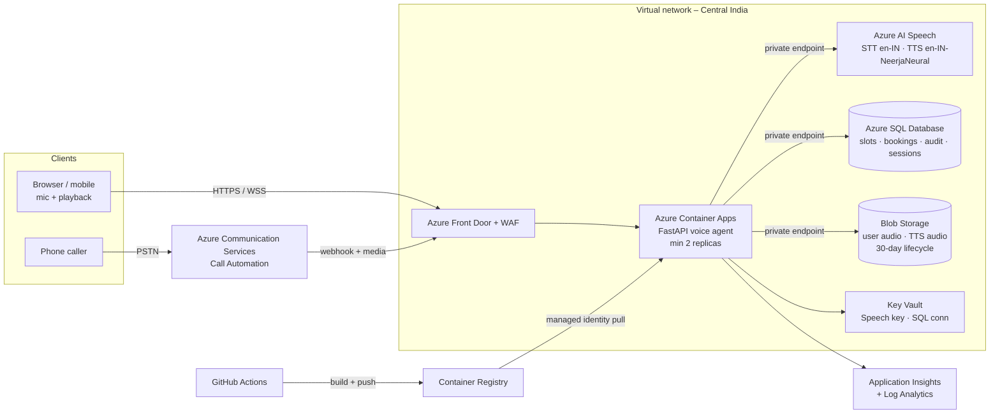

# Azure Deployment Plan — PS02 Voice Appointment Booking Agent

> This document fulfils the `docs/azure-plan.md` requirement.  
> The full technical narrative is in [`docs/azure_hosting.md`](azure_hosting.md).

## Architecture overview



## Compute & storage choices

| Resource | SKU / tier | Reason |
|---|---|---|
| Azure Container Apps | Consumption, 0.5 vCPU / 1 GiB, 2–10 replicas | I/O-bound workload (speech API calls); scales on concurrent HTTP requests |
| Azure AI Speech | S0 standard | Neural TTS (`en-IN-NeerjaNeural`) + short-audio STT (`en-IN`) |
| Azure SQL Database | General Purpose serverless, zone-redundant | Replaces SQLite for multi-replica deployments; same SQL dialect |
| Blob Storage | ZRS, private | User audio uploads + TTS reply WAVs; 30-day lifecycle rule |
| Azure Front Door Premium | WAF (OWASP 3.2), rate-limit rule | TLS termination, DDoS, rate-limit `/sessions*` per IP |
| Key Vault | Standard | Holds Speech key and SQL connection string |
| Container Registry | Basic | Stores the Docker image built by GitHub Actions |
| Application Insights | Pay-as-you-go | Per-turn traces, STT/TTS latency, booking outcome metrics |

Region: **Central India (Pune)** — Speech, SQL, and Container Apps are all available; data stays in India.

## Identity & secret handling

- Container Apps runs with a **system-assigned managed identity**.
- The identity has:
  - `AcrPull` on the registry
  - `Key Vault Secrets User` on the vault
  - `Storage Blob Data Contributor` on the audio container
  - (Optional) Entra ID auth to Speech and Azure SQL — eliminates all keys
- No secrets are baked into the image. The app reads `AZURE_SPEECH_KEY` and `DB_PATH` from Container Apps secret references that point to Key Vault.

## Monitoring & alerting

| Signal | Tool | Alert |
|---|---|---|
| STT/TTS latency per turn | App Insights custom event `voice_turn` | Alert if p95 > 3 s |
| Booking outcomes | App Insights metric `BOOKED` / `BOOK_REJECTED_SLOT_TAKEN` / `CANCELLED` | — |
| Speech 429 / 5xx | App Insights dependency failures | Alert on error rate > 1 % |
| DB deadlocks | Azure SQL Insights | Alert on any deadlock |
| Replica health | Container Apps health probe `GET /health` | Auto-restart on failure |

## Deployment steps

```bash
# 1. Provision infrastructure (Azure CLI)
az group create -n rg-voice-agent -l centralindia
az deployment group create \
  -g rg-voice-agent \
  -f infra/main.bicep \
  -p namePrefix=voiceagent

# 2. Build and push the container image
az acr build -r <acrName> -t voice-agent:1.0 .

# 3. Deploy the app revision
az deployment group create \
  -g rg-voice-agent \
  -f infra/main.bicep \
  -p namePrefix=voiceagent \
     deployApp=true \
     containerImage=<acrLoginServer>/voice-agent:1.0

# 4. Initialise the database (first run only)
az containerapp exec -n voice-agent -g rg-voice-agent \
  --command "python scripts/init_db.py --reset"
```

GitHub Actions (`.github/workflows/ci.yml`) runs `pytest`, then builds and pushes a new image revision on every push to `main`.

## Cost-control assumptions

- Container Apps **scales to 0** when there are no active calls (Consumption plan).
- Azure AI Speech is billed per audio-second (STT) and per character (TTS). A 6-turn booking call ≈ 30 s STT + 1 200 TTS characters — well within the free tier for evaluation.
- Azure SQL serverless **auto-pauses** after 1 hour idle (dev/test); disable auto-pause in production.
- Blob Storage lifecycle rule deletes audio after 30 days to cap storage cost.
- Front Door WAF rate-limiting reduces abuse-driven Speech / SQL charges.

## Limitations & known gaps

- The Bicep template provisions core resources but has not been compiled (no Azure CLI in this environment). Run `az bicep build -f infra/main.bicep` to validate before first deploy.
- Azure STT/TTS classes (`AzureSTT`, `AzureTTS` in `app/speech.py`) follow the documented REST APIs but were exercised only with local engines; no Azure Speech key was available during development.
- Azure SQL migration (`pyodbc` swap) is described in `azure_hosting.md` §3 but not implemented. The local SQLite guarantees carry over unchanged.
- Azure Communication Services telephony adapter is not in this repo.
