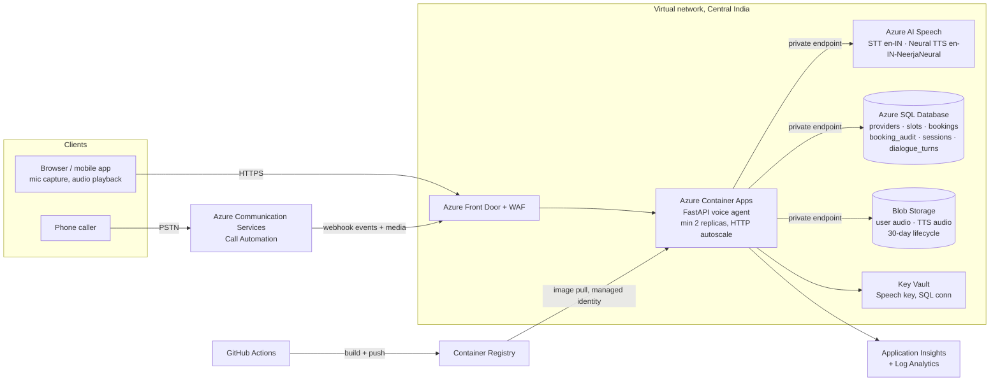
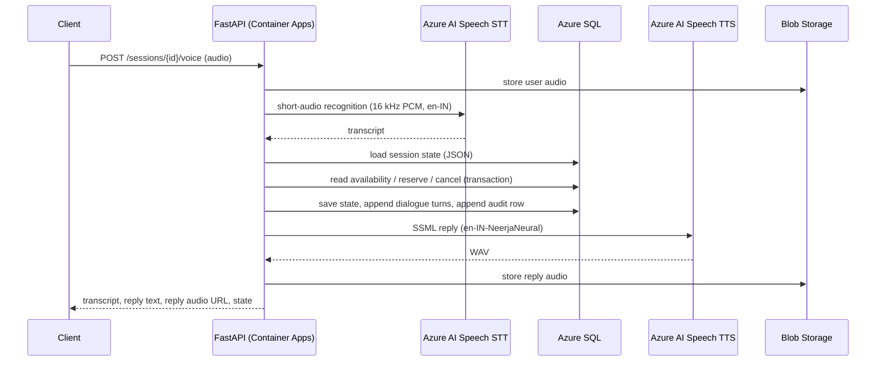

# Azure Hosting Design: API and Speech Components

This describes how the PS02 voice appointment agent runs on Azure. The repository runs locally on
SQLite with local or Azure speech engines. The design below is the production target. Where it
needs code beyond what is in the repo, the section says so.

## 1. Architecture



### Request flow for one voice turn



## 2. Components

| Concern | Azure service | Notes |
|---|---|---|
| API hosting | **Azure Container Apps** (Consumption profile) | Image from the repo `Dockerfile`. Scales on concurrent HTTP requests, minimum 2 replicas for availability. Health probe: `GET /health`. A system-assigned managed identity pulls from ACR and reads Key Vault. |
| Speech to text | **Azure AI Speech**, short-audio REST (`AzureSTT` in `app/speech.py`) | Locale `en-IN`. Turn-based requests of up to 60 s, which fits a booking dialogue. For barge-in or streaming, switch to the Speech SDK over WebSocket (continuous recognition). A phrase list (service names, "BK") improves accuracy, as `initial_prompt` does locally. |
| Text to speech | **Azure AI Speech** Neural TTS REST (`AzureTTS`) | Voice `en-IN-NeerjaNeural`, output `riff-16khz-16bit-mono-pcm`. Booking IDs are spelled digit by digit before synthesis (`speakable()`). |
| Telephony (optional) | **Azure Communication Services** Call Automation | Buys an Indian number, then streams caller audio to the same dialogue manager and plays the TTS replies. Needs a call-automation adapter that is not in this repo. |
| Database | **Azure SQL Database** (General Purpose serverless, zone-redundant) | Replaces SQLite once more than one replica runs. See section 3. |
| Audio storage | **Blob Storage** (private, ZRS) | Replaces the local `data/uploads` and `data/tts_out` folders. Clients get short-lived SAS URLs. A lifecycle rule deletes audio after 30 days. |
| Secrets | **Key Vault** | Speech key and SQL connection, referenced as Container Apps secrets. Better still, use Entra ID auth to Speech and SQL through the managed identity, with no keys at all. |
| Edge | **Azure Front Door Premium + WAF** | TLS, OWASP rules, rate limiting per client IP on `/sessions*`, and private-link origin to Container Apps. |
| Observability | **Application Insights + Log Analytics** | Traces per turn with STT/TTS latency, metrics for booking outcomes (`BOOKED`, `BOOK_REJECTED_SLOT_TAKEN`, `CANCELLED`), and alerts on Speech 429/5xx and on DB deadlocks. |
| Delivery | **GitHub Actions → ACR → Container Apps revision** | Run `pytest` and the voice demo, build, push, deploy a new revision, then shift traffic. |

Region: **Central India (Pune)**. Speech, SQL and Container Apps are all available there, it keeps
latency low for Indian callers, and customer names and recordings stay in India.

### Live calls (WebSocket)

The browser streams microphone audio over `wss://…/ws/calls`. Container Apps ingress supports
WebSockets. Enable **session affinity** so a call stays on one replica for its duration; dialogue
state is still saved to the database every turn. In Azure, swap the local Silero/Whisper path for
the Speech SDK's continuous recognition (`en-IN`, phrase list, semantic segmentation) and streaming
neural TTS. The same `CallSession` events (`user_speech_start`, `transcript`, `agent_text`,
`agent_audio`) carry over unchanged. Front Door supports WebSockets too; set its idle timeout above
the longest expected silence.

## 3. Slot consistency on Azure SQL

The guarantees that hold locally carry over to Azure SQL unchanged:

1. **Conditional claim.** In one transaction:
   `UPDATE slots SET status='booked' WHERE id=@slot AND status='available'`. Only a row count of 1
   proceeds to insert the booking. Under READ COMMITTED the update takes an update lock on the row,
   so two concurrent callers serialize and the second sees `status='booked'`.
2. **Database invariant.** A filtered unique index enforces one confirmed booking per slot even if
   application logic regresses:
   `CREATE UNIQUE INDEX ux_one_confirmed_booking_per_slot ON bookings(slot_id) WHERE status = 'confirmed';`
   SQLite's partial index in `app/db.py` is the same construct.
3. **Audit.** The `booking_audit` insert happens in the same transaction as the change, so neither
   can exist without the other. The app's SQL role gets `INSERT`/`SELECT` only on `booking_audit`
   (`DENY UPDATE, DELETE`), which makes the log append-only.
4. **Times.** Store `start_at` as `datetimeoffset` with `+05:30` and compare in UTC.

Code change required: `app/db.py` and `app/repository.py` use `sqlite3`. Moving to Azure SQL means
swapping the connection layer for `pyodbc` (or SQLAlchemy) and replacing `BEGIN IMMEDIATE` with
`BEGIN TRANSACTION`. The SQL statements themselves already port.

SQLite on an Azure Files share is **not** recommended. SMB file locking is unreliable for SQLite
writers, and it caps you at one replica.

## 4. Dialogue state across replicas

- State is already stored per session (`sessions.state` JSON) and reloaded every turn, so any
  replica can serve any turn and a restart loses nothing. `test_dialogue_state_survives_restart`
  covers this.
- The in-process per-session lock in `DialogueManager` only serializes turns within one replica.
  With several replicas, add a `version` column to `sessions` and save with
  `UPDATE sessions SET state=@s, version=version+1 WHERE id=@id AND version=@v`, retrying on
  conflict. Container Apps session affinity (sticky sessions) also works as a simpler first step.
- Reservations never rely on dialogue state. The database check in section 3 is the final word,
  which is why a stale confirmation in a second session is rejected and audited.

## 5. Security and privacy

- HTTPS only. Front Door WAF. Container Apps ingress restricted to Front Door through private link.
- Managed identity for ACR, Key Vault, Blob and (with Entra auth) Speech and SQL. No secrets in images.
- PII (customer names, voice recordings) is encrypted at rest on SQL (TDE) and Blob (SSE). Recordings
  are deleted after 30 days, and only the transcript stays in `dialogue_turns`.
- Uploads are capped at 10 MB with an allow-list of audio types (`app/main.py`). Front Door applies
  request rate limits.
- Speech private endpoint and `disableLocalAuth=true` once Entra auth is in place.

## 6. Scaling, resilience and cost (indicative)

- Container Apps: 0.5 vCPU / 1 GiB per replica, 2–10 replicas. The API is I/O-bound because speech
  runs on Azure AI Speech.
- Azure AI Speech S0: standard STT and neural TTS are billed per audio hour and per character. A
  6-turn booking call is about 30 s of STT and about 1,200 TTS characters.
- Azure SQL serverless with auto-pause off in production, zone-redundant, point-in-time restore of
  7–35 days.
- Retries with exponential backoff on Speech 429/5xx. If STT fails, the client can fall back to the
  `/text` endpoint.

## 7. Deployment

`infra/main.bicep` provisions the core resources: Log Analytics, Application Insights, Speech
(S0), Blob Storage with a 30-day lifecycle rule, Key Vault holding the Speech key, Container
Registry, a user-assigned identity with AcrPull / Key Vault Secrets User / Blob Data Contributor
roles, the Container Apps environment and the app.

```bash
az group create -n rg-voice-agent -l centralindia
# 1) infrastructure, including the registry
az deployment group create -g rg-voice-agent -f infra/main.bicep -p namePrefix=voiceagent
# 2) build the image in ACR, then create the app from it
az acr build -r <acrName> -t voice-agent:1.0 .
az deployment group create -g rg-voice-agent -f infra/main.bicep \
  -p namePrefix=voiceagent deployApp=true containerImage=<acrLoginServer>/voice-agent:1.0
```

The template pins the app to one replica because the current code keeps SQLite inside the
container. That is fine for a pilot, but data is lost when a revision restarts. Scale to 2–10
replicas after the Azure SQL move in section 3. Azure SQL, Front Door, private endpoints and ACS
are described above but left out of the Bicep to keep it focused.

> The template uses stable API versions but has not been compiled in this environment (no Azure
> CLI). Run `az bicep build -f infra/main.bicep` before the first deployment.
